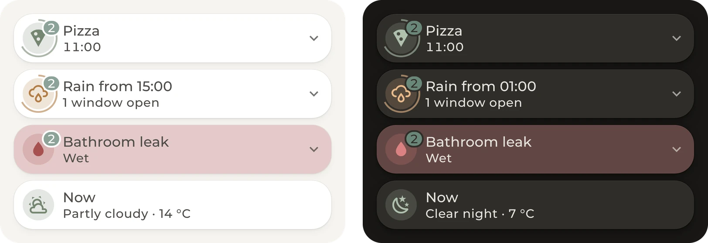
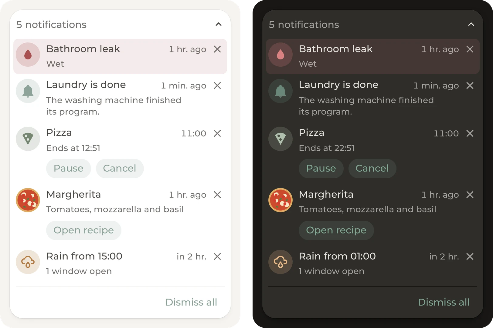
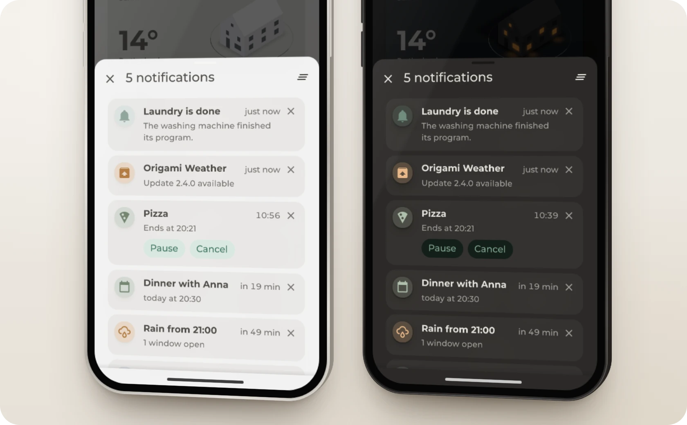
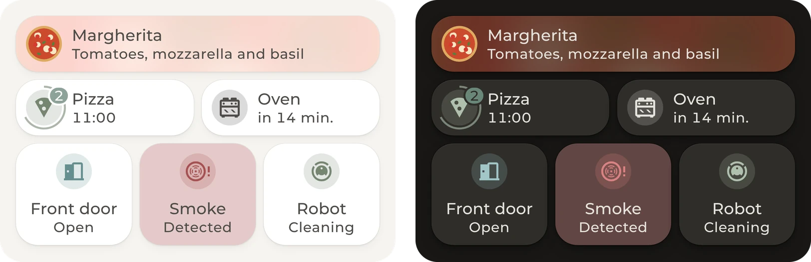
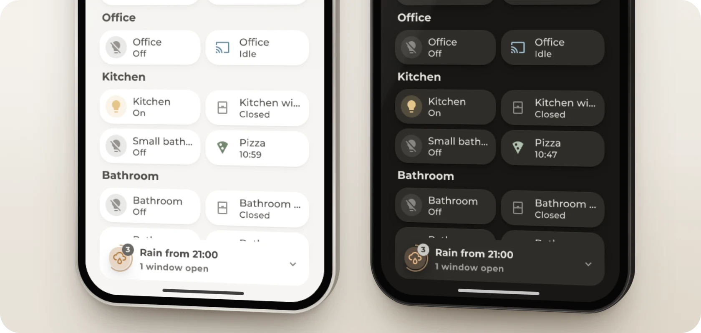
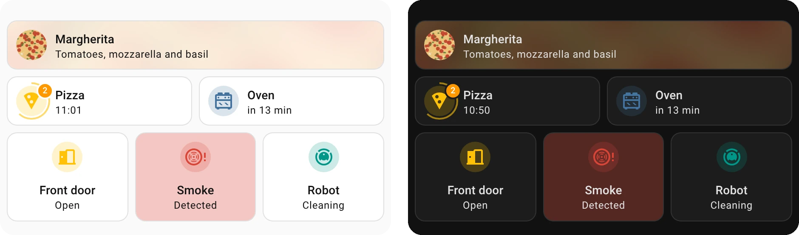

<div>
<a href="https://github.com/hazymorning/origami_notifications/releases/latest"></a>
<a href="https://github.com/hazymorning?tab=repositories&q=origami"></a>
</div>

Origami Notifications is a card for Home Assistant that shows what needs attention right now. Home Assistant's notifications and updates appear without any setup, and every entity added to it appears only when it matters, such as a timer while it runs.

[Get started](#get-started) · [Card](#card) · [Entities](#entities) · [Weather](#weather) · [Infos](#infos) · [More](#more)

## Get started

<details>
<summary><b>Install the card</b></summary>

<br>

Origami Notifications needs Home Assistant 2026.4 or newer.

1. Open Origami Notifications in HACS. If HACS asks to add the repository, select **Add**. Then select **Download**.

   [](https://my.home-assistant.io/redirect/hacs_repository/?owner=hazymorning&repository=origami_notifications&category=plugin)

2. Reload the page.

Without HACS, copy [`dist/origami-notifications.js`](https://github.com/hazymorning/origami_notifications/blob/main/dist/origami-notifications.js) to `/config/www`, add `/local/origami-notifications.js` as a **JavaScript module** under [Resources](https://my.home-assistant.io/redirect/lovelace_resources/) and reload the page.

</details>

<details>
<summary><b>Add the card</b></summary>

<br>

1. Edit a dashboard and add the **Origami Notifications** card.
2. Add the entities to watch.

The visual editor covers every option except `actions`, which go in YAML.

</details>

## Card



One entry at a time, and every 8 seconds the next. Warnings, such as rain with a window open, get an orange icon. Smoke, a leak or a triggered alarm makes the card pulse red, and it stays on that entry.

### List



A tap on the card shows all entries. On a wide card, the list opens inside the card.



A card narrower than 300 pixels opens the list in a Home Assistant dialog instead, which slides up from the bottom on a phone.

<details>
<summary><b>Taps and swipes</b></summary>

<br>

| Action | What happens |
| --- | --- |
| Tap the card | The list opens. With only one entry and nothing else to show, the tap opens that entry instead. |
| Swipe the card or press an arrow key | The card switches to the next or the previous entry. |
| Tap an entry | The entry's entity opens. A notification opens its first link instead, and a repair opens the repairs page. |
| Tap an entry whose message is cut off | All of the text shows, and a tap on the icon opens the entry. An entry that opens nothing also shows its whole title. |
| Tap the cross | The entry is dismissed. |

| Detail | Description |
| --- | --- |
| Ring | The ring around the icon fills until the card switches to the next entry. |
| Badge | The badge counts the entries. |
| Order | Critical entries come first. The rest are sorted by time, and the one closest to now comes first. |
| Groups | Two or more open windows share one row that names their rooms. Doors, motion sensors and other binary sensors of one type work the same way. |

</details>

<details>
<summary><b>Dismissing</b></summary>

<br>

| Entry | What dismissing does |
| --- | --- |
| A Home Assistant notification | It's removed for everyone. |
| A repair | It's ignored in Home Assistant. |
| An update | For an admin, it's skipped in Home Assistant. For everyone else, and for updates that install themselves, it's hidden in this browser. |
| Anything else | It's hidden in this browser until it changes or happens again. A bin, for example, comes back for the next pickup. |
| An alarm panel or an entity under `infos` | It can't be dismissed. |
| All entries at once | With two or more entries, **Dismiss all** appears at the foot of the list. In the dialog, it's the icon at the top. It dismisses every entry that can be dismissed. |

</details>

### Sizes



The card needs at least half the width of a section, or a quarter with `vertical: true`. With `background: true` on an entity, its picture shows behind the card.

### Footer



In the footer of a sections view, the card stays at the bottom of the screen.

### Theme



The card follows the theme. The images above use the [Origami](https://github.com/hazymorning/origami) theme, and with the default theme the card looks like a tile card.

## Entities

Almost any entity works under `entities`, and the card works out what kind it is. Each kind appears only at certain times or in certain states.

<details>
<summary><b>Kinds</b></summary>

<br>

| Entity | When it appears |
| --- | --- |
| Alarm panel | While it's triggered, pending or arming. |
| Alert | While it's on. |
| Calendar | While an event runs. With `before`, also that long before the next event starts. |
| Update | While an update is available. |
| Entity with warnings, such as DWD, NINA or Meteoalarm | Each warning appears as its own row until it ends. A warning for later appears right away and shows when it starts. A severe warning makes the card pulse red. |
| Timer | While it runs or is paused, with buttons to pause, resume and cancel it. |
| Sensor with a time, or with a duration and `type: countdown` | Until the time is reached. With `before`, only that long before. |
| Bins from Waste Collection Schedule, as a sensor or a calendar | From noon the day before until the end of the pickup day. |
| The Android app's next alarm | In the 12 hours before the alarm rings. |
| Event | For a day after it fires. If the same device has a camera, the entry shows its picture. |
| To-do list with `type: todo` | Each item on its due day or when it's overdue, with a button to mark it as done. Items without a due date never appear. |
| Lock, cover, valve, vacuum, lawn mower or siren | While Home Assistant counts it as active, such as an unlocked lock or an open cover. Where the device supports it, a button locks, closes, docks or turns it off. |
| Entity with an attribute that holds a `name` or `title` and a `description`, `summary` or picture | The attribute appears as an entry, whatever the entity's state. The recipe in the list above works like this. |
| Binary sensor for smoke, gas, carbon monoxide, moisture, heat or safety | While it's on, and the card pulses red. |
| Anything else | While it's on or active, or while its value is above 0. |

</details>

<details>
<summary><b>Entity options</b></summary>

<br>

| Option | Description |
| --- | --- |
| `type` | The kind of entity. Without it, the card finds the kind itself. It's one of `alarm`, `alert`, `attribute`, `calendar`, `countdown`, `device`, `event`, `generic`, `next_alarm`, `picture`, `timer`, `todo`, `update`, `warning` or `waste`. With `generic`, the entity appears in any state except off, idle, none, 0, unknown and unavailable. With `picture`, the state becomes the title. |
| `attribute` | The attribute to show, such as `next_due` or `book.title`. A plain value becomes the title. |
| `name` | A name in place of the entity's name |
| `icon` | An icon in place of the entity's icon |
| `color` | A theme color such as `green`, as on a tile, or any CSS color. Critical entries stay red, and warnings stay orange. |
| `image` | A picture from an attribute, or a URL, in place of the entity's own picture |
| `background` | `true` shows the entry's picture blurred behind the card while this entry shows. |
| `before` | How long before its time the entry appears, in minutes or as a duration in quotes such as `"1:30:00"`. It works for calendars, bins, the next alarm, countdowns and to-do lists. |
| `tap_action` | What a tap on the entry does. By default, a tap opens the entity. |
| `visibility` | Conditions from Home Assistant's visibility tab, which must all be met. An entity that fits none of the kinds above, such as a temperature, then appears whenever they are met. |
| `actions` | Buttons of one's own, each with a `label` and a `tap_action`. The **Open recipe** button in the list above is one of these. |

</details>

## Weather

With a weather entity under `weather`, the card warns of rain, snow, hail, thunderstorms and frost before they start. The entity needs an hourly or twice daily forecast.

<details>
<summary><b>When the weather appears</b></summary>

<br>

| Entry | When it appears |
| --- | --- |
| Rain, snow, hail or thunderstorms | While it's dry, up to 6 hours ahead, with the chance of rain. |
| Frost | While it's above freezing, up to 18 hours before the first hour below 0 °C or 32 °F, with the lowest temperature of the next 18 hours. |
| Rain with a window open | While a window is open, the rain entry becomes an orange warning that says how many windows are open. It then also appears when the rain has already started. |

</details>

## Infos

Entities under `infos` show after the entries, such as the forecast or the next sunrise. While one of them shows, the card doesn't hide.

<details>
<summary><b>Info options</b></summary>

<br>

| Option | Description |
| --- | --- |
| `entity` | The entity to show |
| `name`, `icon`, `color`, `show_entity_picture` | These work as on a tile card. Without a name, a calendar shows its event as the title, and a weather entity shows the time, such as Now or Tomorrow. |
| `state_content`, `time_format` | What the second line shows, such as `[temperature, state]` or `next_rising` |
| `forecast_type` | `daily`, `hourly` or `twice_daily` adds a weather entity's forecast. |
| `forecast_slots` | How many days or hours of the forecast the card shows. The default is 1. |
| `show_current`, `show_forecast` | These work as on Home Assistant's weather forecast card. Both are on unless set to `false`. |
| `tap_action`, `hold_action`, `double_tap_action` | What a tap, a hold and a double tap do. By default, a tap opens the entity. A hold and a double tap work only on the closed card, not in the list. |
| `visibility` | Conditions from Home Assistant's visibility tab. The entity shows only while all of them are met. |

</details>

## More

<details>
<summary><b>Card options</b></summary>

<br>

| Option | Default | Description |
| --- | --- | --- |
| `entities` | | The entities to watch, see [Entities](#entities) |
| `label` | | The card also watches every entity with this label. In YAML, it takes the label's ID. |
| `weather` | | A weather entity for rain, snow and frost ahead, see [Weather](#weather) |
| `infos` | | Entities that show after the entries, see [Infos](#infos) |
| `updates` | `true` | Shows every available update. `false` shows only the updates under `entities`. |
| `repairs` | `true` | Shows repairs to admins. `false` hides them. |
| `hide_when_empty` | `true` | Hides the card when there is nothing to show. With `false`, the card stays and also shows the weather and the next calendar events after the entries. |
| `vertical` | `false` | `true` puts the icon above the text, as on a tile card with vertical content. In a sections view, the card can then be as narrow as 3 columns instead of 6. |
| `rotate` | `8` | How many seconds the card shows each entry before the next. At `0`, it stays on one entry, and a swipe still switches. |
| `slide` | `up` | Whether the text slides `up` or to the `side` when the card switches. A swipe always slides it to the side. |
| `audience` | | Who sees which entries, see Who sees what below |
| `css` | | CSS of one's own, see Styling below |

</details>

<details>
<summary><b>Who sees what</b></summary>

<br>

With `only`, just the people listed see the entries. With `except`, everyone else does. In this example, only Anna sees Home Assistant's notifications, and the kid doesn't see the weather warnings.

```yaml
audience:
  system:
    only: [person.anna]
  sensor.dwd_weather_warnings:
    except: [person.kid]
```

| Key | Covers |
| --- | --- |
| `system` | Home Assistant's notifications |
| `updates` | All updates |
| `repairs` | Repairs, which only admins see |
| An entity ID | That entity. The weather entity's ID covers its rain and frost entries. |

The card knows people by the user account linked to them under [People](https://my.home-assistant.io/redirect/people/). The rules only change this card, not what people see elsewhere in Home Assistant.

</details>

<details>
<summary><b>Styling</b></summary>

<br>

Styles in `css` come after the card's own, so they win.

| Variable | Default | Description |
| --- | --- | --- |
| `--origami-pad`, `--origami-gap` | `10px`, `10px` | The padding, and the space between icon and text |
| `--origami-tile`, `--origami-icon` | `36px`, `24px` | The size of the icon area on the card, and of the icon |
| `--origami-row-tile` | `40px` | The size of the icon area in the list |
| `--origami-radius` | `8px` | The corner radius of the rows |
| `--origami-card-bg`, `--origami-row-bg` | theme, none | The card's and the rows' background |
| `--origami-hover`, `--origami-focus` | light tint, theme | The hover tint and the keyboard focus ring |
| `--origami-pulse-opacity` | `0.3` | How strongly the card pulses while an entry is critical. This also works in a theme. |
| `--origami-max-height` | none | The maximum height of the card and its dialog. A longer list scrolls inside. The default is `25dvh` in the footer and `70vh` in the dialog. This also works in a theme. |
| `--origami-bg-opacity`, `--origami-bg-blur` | `0.22` (`0.32` dark), `24px` | The opacity and blur of the background picture. These also work in a theme. |
| `--ha-tile-*` | theme | The card follows the theme's tile variables. The icon and the ring around it take their shape from `--ha-tile-icon-border-radius`. |
| `--ha-button-*` | theme | The buttons in the list follow the theme's button variables, such as `--ha-button-border-radius`. |
| `--ha-dialog-surface-background` | theme | The background of the dialog. In a theme, it colors every dialog of Home Assistant. |

| Part | Classes |
| --- | --- |
| Card | `.head` with `.icon`, `.cycle` for the ring, `.badge`, `.title` and `.secondary` |
| List | `.bar` with `.count`, the `.list` of `.row` elements and the `.foot` with `.clear` |
| Row | `.icon`, `.title`, `.time`, `.dismiss`, `.message` and the `.actions` with `.action` buttons. The dialog uses the same classes. |
| Dialog | `.heading` for the title at the top |
| Row state | `.warn` or `.crit`, and the kind in `data-kind`, such as `update`, `weather` or `group` |
| Background picture | `.backdrop` |

</details>

<details>
<summary><b>Full example</b></summary>

<br>

```yaml
type: custom:origami-notifications
weather: weather.home
label: notify
hide_when_empty: false
rotate: 6
slide: side
entities:
  - binary_sensor.front_door
  - cover.garage_door
  - timer.pizza
  - sensor.dwd_weather_warnings
  - entity: sensor.dinner
    background: true
    actions:
      - label: Open recipe
        tap_action:
          action: url
          url_path: https://tandoor.dev
  - entity: calendar.family
    before: 120
  - entity: todo.chores
    type: todo
  - entity: sensor.paper_bin
    type: waste
    color: blue
  - entity: sensor.washer_remaining
    type: countdown
    before: 10
  - entity: event.cat_flap
    name: Chelsea
    image: /local/chelsea.jpg
  - entity: sensor.attic_temperature
    visibility:
      - condition: numeric_state
        above: 28
  - entity: binary_sensor.doorbell
    tap_action:
      action: navigate
      navigation_path: /dashboard-home/cameras
    actions:
      - label: Open the door
        tap_action:
          action: perform-action
          perform_action: lock.open
          target:
            entity_id: lock.front_door
infos:
  - entity: weather.home
    forecast_type: twice_daily
    forecast_slots: 2
  - entity: sun.sun
    name: Sunrise
    state_content: next_rising
    visibility:
      - condition: state
        entity: sun.sun
        state: below_horizon
audience:
  updates:
    only: [person.anna]
  sensor.dwd_weather_warnings:
    except: [person.kid]
css: |
  :host {
    --origami-pad: 16px;
    --origami-tile: 40px;
    --origami-max-height: 60vh;
  }
  .row[data-kind="update"] { opacity: 0.6; }
```

</details>

<details>
<summary><b>Troubleshooting</b></summary>

<br>

**The card doesn't appear.** The card hides while there is nothing to show, but it always appears while the dashboard is edited. `hide_when_empty: false` keeps it visible.

**Rain and frost never appear.** The weather entity needs an hourly or twice daily forecast, and it goes under `weather`, not under `entities`, where it shows nothing.

**Another device still shows a dismissed entry.** Most entries are hidden only in the browser where they were dismissed.

</details>
